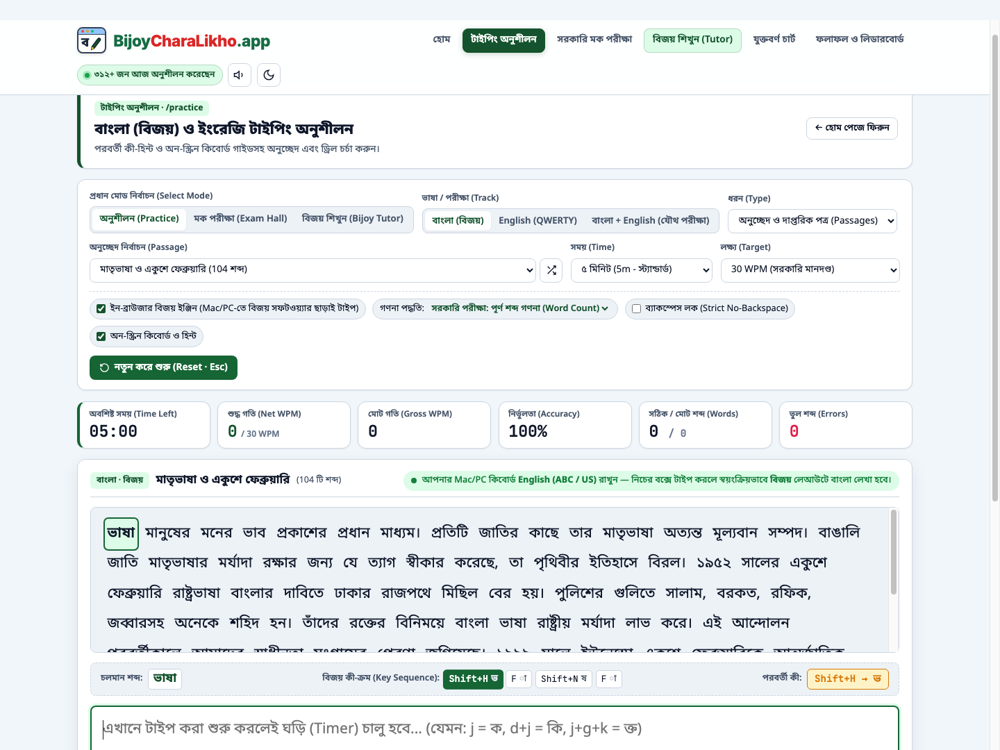
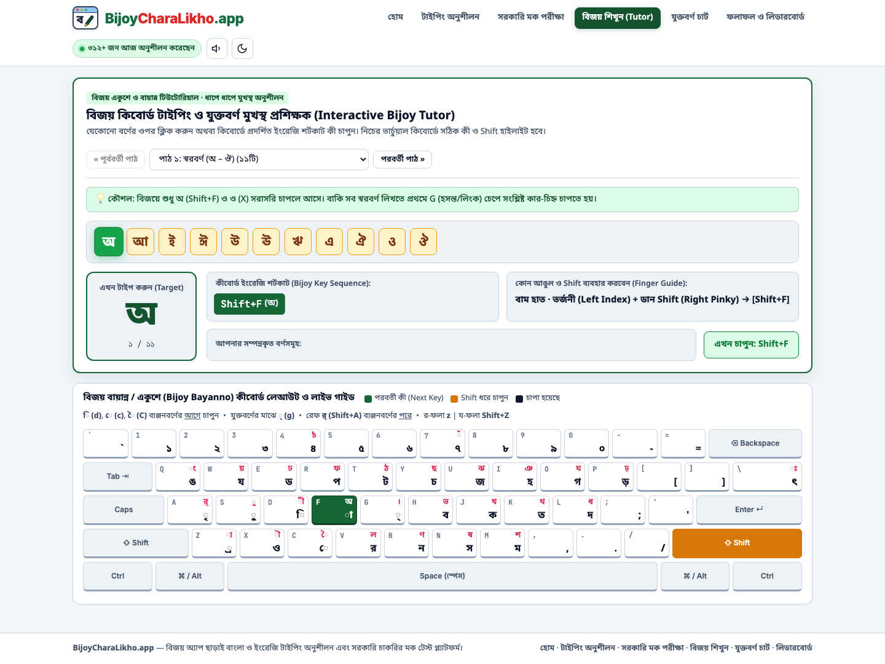
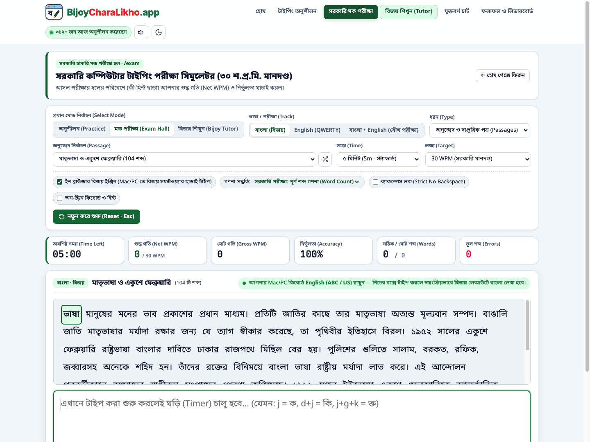
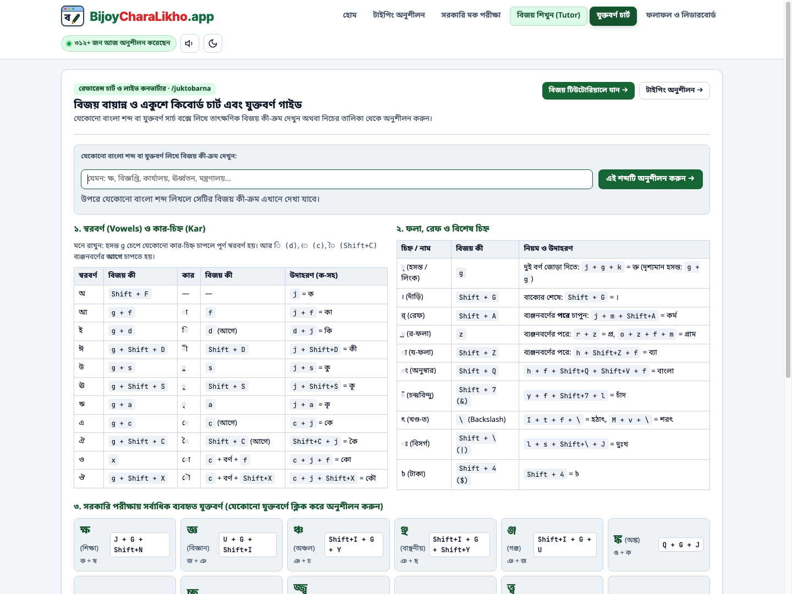
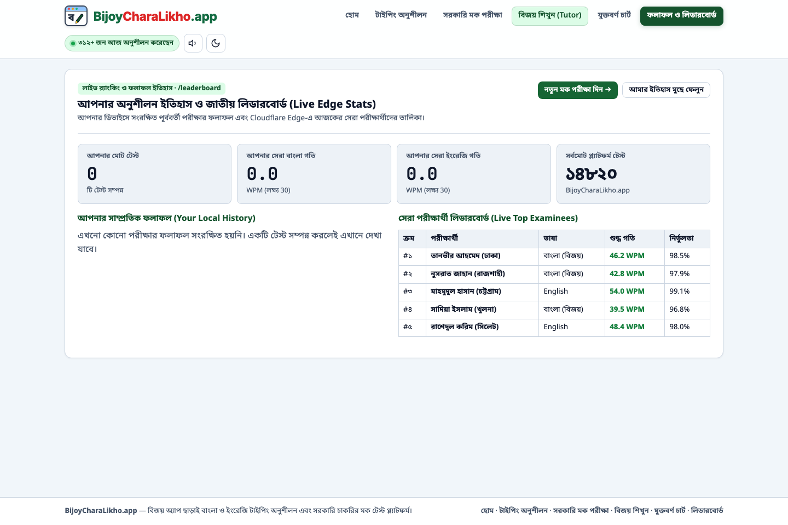

# BijoyCharaLikho.app — বিজয় অ্যাপ ছাড়াই বাংলায় লিখুন!

**Zero-install browser-native Bangla (Bijoy Bayanno/Ekushe) & English typing practice, step-by-step interactive tutor, and authentic Bangladesh Government job exam simulator across Mac, Windows, Linux & Mobile.**

<h2 align="center">
  Try it live: <a href="https://bijoycharalikho.app">🔗 https://bijoycharalikho.app</a>
</h2>

---

## 🎬 Live Demo & Overview Banner

> **Video Walkthrough:** *(To embed a native video player on GitHub, edit this `README.md` on GitHub and drag-and-drop your `.mp4` or `.mov` screen recording right below this line)*

<!-- DRAG AND DROP YOUR SCREEN RECORDING (.mp4 / .mov) HERE IN GITHUB WEB EDITOR -->

---

## 🔗 Live Multi-Page Routes

Every core module of **BijoyCharaLikho.app** runs on its own dedicated URL route with instant client-side navigation and server-backed SEO metadata:

| Page / Module | Live Link | What It Does |
| :--- | :--- | :--- |
| **🏠 Home Landing Hub** | **[bijoycharalikho.app/](https://bijoycharalikho.app/)** | Welcome hero, platform directory, and Bangladesh government typing exam rules & FAQ |
| **⌨️ Typing Practice** | **[bijoycharalikho.app/practice](https://bijoycharalikho.app/practice)** | Bangla (Bijoy) & English passages, custom text mode, live next-key hint bar, and on-screen virtual keyboard |
| **🏛️ Gov Mock Exam Hall** | **[bijoycharalikho.app/exam](https://bijoycharalikho.app/exam)** | Official exam simulator (hint-free exam hall, optional strict no-backspace lock, single or combined Bangla + English exam) |
| **🎓 Interactive Bijoy Tutor** | **[bijoycharalikho.app/tutor](https://bijoycharalikho.app/tutor)** | 14-lesson step-by-step Bijoy Ekushe memorization curriculum (vowels, kar signs, consonants, and 150+ conjuncts with hand/finger/Shift guidance) |
| **📖 Juktobarna & Key Chart** | **[bijoycharalikho.app/juktobarna](https://bijoycharalikho.app/juktobarna)** | Real-time Bangla word-to-Bijoy keystroke solver, cheat sheet tables, and one-click custom conjunct drill launcher |
| **🏆 Results & Leaderboard** | **[bijoycharalikho.app/leaderboard](https://bijoycharalikho.app/leaderboard)** | Local performance history, personal best WPM tracker, and live national examinee leaderboard powered by Cloudflare Edge |

---

## 📸 Live Application Screenshots

### 1. Home Page (`https://bijoycharalikho.app/`)

### 2. Typing Practice Workspace & Virtual Bijoy Keyboard (`https://bijoycharalikho.app/practice`)

### 3. Step-by-Step Interactive Bijoy Tutor (`https://bijoycharalikho.app/tutor`)

### 4. Government Mock Exam Hall Simulator (`https://bijoycharalikho.app/exam`)

### 5. Live Juktobarna Keystroke Solver & Reference Guide (`https://bijoycharalikho.app/juktobarna`)

### 6. Personal Analytics & Live National Leaderboard (`https://bijoycharalikho.app/leaderboard`)

---

## 💡 The Problem We Solved

Every year in Bangladesh, hundreds of thousands of candidates sit for practical typing tests across government ministries, courts, banks, and BCC recruitment exams (*Computer Operator, Office Assistant cum Computer Typist / অফিস সহকারী কাম-কম্পিউটার মুদ্রাক্ষরিক, Data Entry Operator*):

1. **Mandatory Bijoy Keyboard Layout:** Recruitment centers require typing in the **Bijoy (বিজয় বায়ান্ন / একুশে)** layout (phonetic layouts like Avro are not permitted in practical exams).
2. **Cross-Platform Barrier:** Candidates using **macOS, Linux, Chromebooks, or tablets/phones**—or Windows users without commercial desktop software—cannot easily practice the traditional Bijoy layout.
3. **Pre-Kar Reordering & Conjunct Complexity:** In Bijoy, pre-base vowel signs (`ি`, `ে`, `ৈ`) must be typed *before* the consonant or conjunct cluster (`d + j + g + k` $\rightarrow$ `ক্তি`), while Unicode stores them *after* the consonant cluster.
4. **Authentic Evaluation Rules:** Government typing tests score candidates using word-level deductions rather than standard international 5-character stroke formulas.

**BijoyCharaLikho.app** solves all four challenges in a zero-dependency, browser-native web application.

---

## ⚙️ Core Engineering Highlights

### 1. Client-Side Bijoy Finite-State Transducer (FST)
- Intercepts physical keystrokes via `KeyboardEvent.code` so users keep their OS keyboard set to **English (US / ABC)** while typing authentic **Bijoy Bayanno / Ekushe** Bangla Unicode directly in the browser.
- Automatically buffers pre-base vowels (`d` $\rightarrow$ `ি`, `c` $\rightarrow$ `ে`, `Shift+C` $\rightarrow$ `ৈ`) across single consonants and multi-consonant conjunct chains (`g` $\rightarrow$ `্`), composes two-part vowels (`c` + consonant + `f` $\rightarrow$ `ো`, `c` + consonant + `Shift+X` $\rightarrow$ `ৌ`), forms independent vowels (`g + d` $\rightarrow$ `ই`, `g + f` $\rightarrow$ `আ`), and reorders post-cluster Reph (`Shift+A` $\rightarrow$ `র্` to the start of the syllable cluster).
- Includes an **Inverse Keystroke Solver** that decomposes any Unicode Bangla word into its exact sequence of Bijoy keys in real time.

### 2. Dynamic Programming Word Alignment & Dual Scoring Engine
- Normalizes Unicode strings (NFC + canonicalization of decomposed nukta variants `ড়, ঢ়, য়` and two-part vowel signs) so identical visual strings never trigger false-positive errors.
- Uses **Wagner–Fischer edit-distance alignment** at the word level to classify every word as **Correct**, **Substituted (Wrong Spelling)**, **Deleted (Skipped Word)**, or **Inserted (Extra Word)**—ensuring a single skipped word never cascades into marking the rest of the passage wrong.
- Computes both the **Bangladesh Government Word-Count Formula** and the **International 5-Stroke Formula** side-by-side on the printable evaluation report.

### 3. 14-Stage Interactive Bijoy Ekushe Memorization Tutor
- Guides learners through **220+ characters, conjuncts (Juktobarnas), and sentences** with visual target spotlights, exact keystroke recipes, and **Hand + Finger + Left/Right Shift** ergonomics.

### 4. Serverless Edge Backend on Cloudflare Pages Functions
- Uses **Cloudflare Pages Functions (`/api/stats`)** at the edge to serve live daily participant counters, global exam totals, national leaderboards, and instant post-exam percentile rankings.

---

## 🛠️ Tech Stack

- **Frontend:** Semantic HTML5, Modern CSS3 (Custom Properties, Grid/Flexbox, Light/Dark & Print stylesheets), Vanilla ES6+ JavaScript (Zero runtime framework overhead)
- **Typing & Scoring Engine:** Custom Finite-State Transducer (FST), Unicode NFC Normalizer, Dynamic Programming Edit-Distance Alignment
- **Audio Feedback:** Web Audio API synthesized mechanical key-click & error tones
- **Edge Backend & Hosting:** Cloudflare Pages & Cloudflare Pages Functions (Serverless Workers)
- **Quality Assurance:** Automated Node.js unit test suite verifying 100% round-trip accuracy across all Bangla passages and 220+ tutor items

---

## 📄 License & Portfolio Notice

**Copyright © 2026 [Muntasir Malek Utsho](https://github.com/MuntasirMalek). All Rights Reserved.**

This repository serves as the **official public portfolio showcase** for **[https://bijoycharalikho.app](https://bijoycharalikho.app)**. The underlying source code is proprietary and maintained in a private production repository.

*Disclaimer: "Bijoy" and "Bijoy Ekushe" are registered trademarks of Ananda Computers. BijoyCharaLikho.app is an independent browser-based educational platform and is not affiliated with or endorsed by Ananda Computers.*
